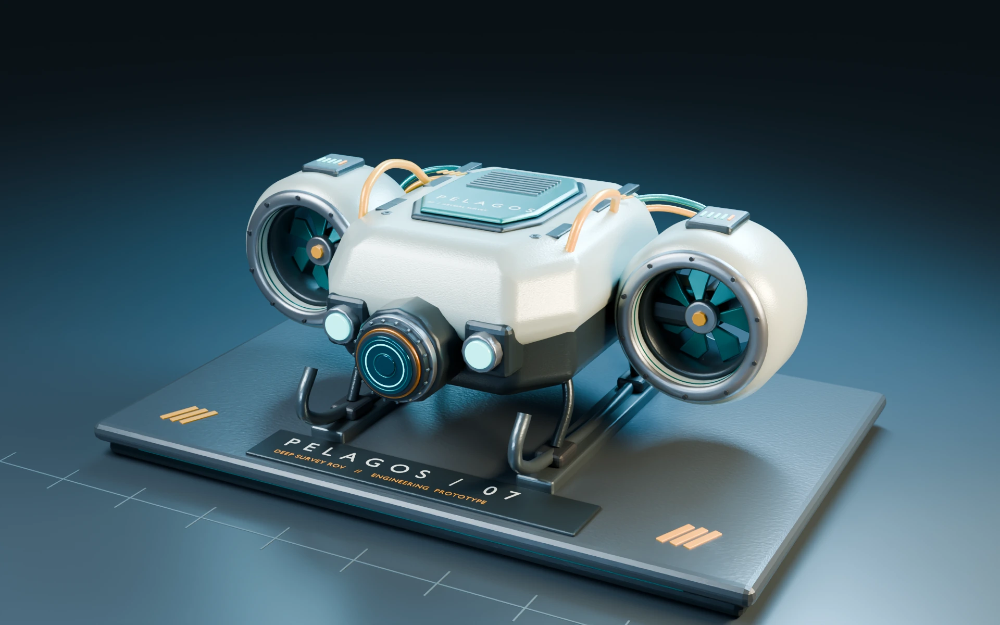
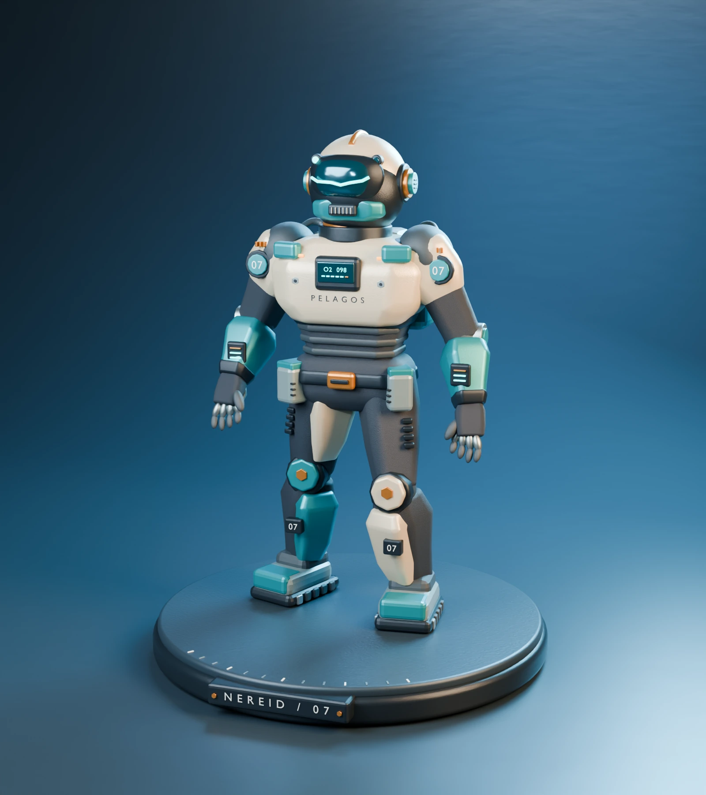

# Blender MCP Pro

[](https://github.com/camilin7483/blender-mcp/actions/workflows/ci.yml)
[](https://github.com/camilin7483/blender-mcp/releases/tag/v4.9.0-alpha.2)

Blender MCP Pro connects an MCP client to Blender for precision 3D modeling,
rigging, scene inspection, rendering, and export. The default `full` profile
exposes **313 tools across 25 categories**. The bridge communicates with the
MCP client over stdio and sends authenticated requests to Blender on
`localhost:9876`.

[Install](#installation) · [What's new](#whats-new) · [Find a tool](docs/tools.md)
· [Run a workflow](docs/workflows.md) · [Download the scenes](#showcase)

## What's new

The published [v4.9.0-alpha.2 build](docs/releases/v4.9.0-alpha.2.md)
includes the v4 character, scene and pipeline tool packs. The independent
audit and performance update made these changes.

| Area | Implementation |
| --- | --- |
| Characters | A connected procedural body mesh, layered eyes, anatomical head, dental arch, skin material, garment shells, curve grooms, a 39-bone rig, a studio, and a structural quality report. |
| Rig performance | UVs are written in bulk. Blender computes automatic weights on the base mesh when the only modifier is visible subdivision. The subdivision, selection and active object are restored after binding. |
| Geometry | Audits use evaluated meshes to check BVH overlap, solid containment, support, symmetry and topology. Strict mode can require clean topology and a support path to the ground. |
| Exports | The exporter validates the final path and checks that it wrote a file. Game export profiles can reimport the result to measure dimensions and report imported meshes, materials, armatures and actions. |
| Local dispatch | Requests that expire before execution are cancelled. If a mutation already started, inspect the scene before retrying after a timeout. |

The [`main` branch](https://github.com/camilin7483/blender-mcp/tree/main)
also contains the PELAGOS 07 and NEREID 07 scenes, SHA-256-verified Blender
download mirrors, installed-extension smoke tests on both Linux Blender
versions, and the tool reference generated from the MCP registry. See the
[changelog](CHANGELOG.md) for the implementation history.

## Showcase

**PELAGOS 07** is an original subsea inspection vehicle with a ceramic pressure
hull, ducted thrusters and an optical sensor assembly.

[](docs/showcase/README.md#pelagos-07)

**NEREID 07** is its humanoid survey pilot. Its 35-bone rig articulates the
segmented pressure suit, including the hands and fingers.

<a href="docs/showcase/README.md#nereid-07"></a>

Both images were rendered with Cycles in Blender's background mode. The
[showcase guide](docs/showcase/README.md) includes the editable `.blend` files,
detail renders, measured checks, and commands to regenerate the scenes.

## Installation

Use Blender 4.5 or 5.2 LTS with a separate Python 3.10+ environment for the
bridge. The Linux test matrix uses Blender 4.5.4 and 5.2.4.

1. Download [`blender_mcp_pro-4.9.0.zip` from v4.9.0-alpha.2](https://github.com/camilin7483/blender-mcp/releases/download/v4.9.0-alpha.2/blender_mcp_pro-4.9.0.zip).
2. In Blender, open **Edit → Preferences → Get Extensions**. Use the top-right
   menu to select **Install from Disk**, then select the ZIP. Enable the
   **Blender MCP Pro** extension if prompted.
3. Open the 3D Viewport sidebar with **N** and select **MCP Pro** to see the
   connection status. If needed, click **Start Server**.
4. Set up the MCP bridge in its own Python 3.10+ environment. Use the source
   matching your installation. For the published ZIP:

   ```bash
   git clone --branch v4.9.0-alpha.2 https://github.com/camilin7483/blender-mcp.git
   cd blender-mcp
   python3 -m venv .venv
   .venv/bin/python -m pip install .
   ```

   On Windows, use `py -3 -m venv .venv` and
   `.\.venv\Scripts\python.exe -m pip install .`.

5. Configure the MCP client to launch the bridge by its absolute path. The
   Windows executable is `.venv\Scripts\blender-mcp.exe`. Escape each backslash
   as `\\` in a JSON path.

   ```json
   {
     "mcpServers": {
       "blender-mcp-pro": {
         "command": "/absolute/path/to/blender-mcp/.venv/bin/blender-mcp"
       }
     }
   }
   ```

Ask the client to run `get_scene_info` to verify the connection.
[Build from `main`](pro/README.md#build-from-source) for the current development
version.
[Configuration details](pro/README.md#local-configuration) cover the auth token,
profiles and output directory. The [v3 migration guide](docs/migration-v3-v4.md)
covers the single-file legacy add-on in [`legacy/`](legacy/). Both editions use
the same local port, so enable one at a time.

## Tools and profiles

The [complete reference](docs/tools.md#categories) lists every tool and its
required and optional arguments. Download the [JSON catalog](docs/tool-schemas.json)
for types, defaults and profile membership.

| Task | Start with |
| --- | --- |
| Discover tools and inspect the scene | `tools_search`, `tools_describe`, `get_scene_info`, `get_object_info` |
| Model parts and assemblies | `create_parametric_part`, `create_lathe_part`, `create_curve_sweep`, `create_loft_surface`, `create_assembly` |
| Place parts and check fit | `list_semantic_anchors`, `anchor_operation`, `validate_constraints`, `audit_3d_model` |
| Work on characters and poses | `create_character_body_pro`, `create_character_rig_pro`, `set_bone_rotation`, `character_quality_report` |
| Build environments | `create_room_shell`, `create_city_block`, `create_terrain`, `create_tree`, `create_water_plane` |
| Create materials and textures | `create_procedural_material`, `smart_uv_unwrap`, `pack_uv_islands`, `bake_normal_map` |
| Animate and simulate | `keyframe_object`, `create_turntable_animation`, `add_rigid_body`, `add_cloth`, `bake_simulation` |
| Light and inspect scenes | `create_light`, `create_camera`, `render_still`, `render_multiview_inspection` |
| Find and import assets | `search_polyhaven_assets`, `search_sketchfab_models`, `import_model` |
| Prepare an export | `export_preflight`, `export_scene`, `create_lod_chain`, `generate_asset_manifest` |

The bridge offers [29 profiles](docs/tools.md#profiles). Set
`BLENDER_MCP_PROFILE` in the bridge environment and restart it. Use `nano`
(13 tools) for compact discovery and inspection, `core` (19) for general
scene work, `guided` (34) for a short creation-to-export workflow, or a
specialized profile such as `character` (55) or `modeling` (50).

## Workflows

- [Model and resize a desk](docs/workflows.md#build-and-inspect-a-desk) using a metric assembly, then render it from four angles.
- [Build and check a character rig](docs/workflows.md#create-and-verify-a-character-rig) and inspect the twelve v4.9 character tools.
- [Validate and export a GLB](docs/workflows.md#validate-and-export-a-glb) with the file, preflight, and reimport checks.

## Compatibility and verification

Linux CI runs Blender **4.5.4 LTS** and **5.2.4 LTS** with the real headless
geometry and GUI socket suites, the 46-task functional benchmark, and extension
package validation. Windows and macOS have Python and experimental headless
Blender lanes. See the [platform matrix](docs/compatibility.md) for each lane's
coverage.

```bash
python3 -m venv .venv
.venv/bin/python -m pip install -r requirements-dev.txt -r pro/requirements.txt
.venv/bin/python -m pytest tests/contracts tests/unit tests/integration -q
BLENDER_BIN=/path/to/blender ./scripts/run_blender_tests.sh
BLENDER_BIN=/path/to/blender ./scripts/run_bench.sh --runs 3 --output out/bench
```

The GUI socket suite uses the Blender event loop. On Linux without a display,
the test script uses `xvfb-run`. The showcase generators run in background mode
and call the modeling code on Blender's main thread.

## Documentation

- [Pro setup and configuration](pro/README.md)
- [Architecture](ARCHITECTURE.md)
- [Benchmarks and reproduction](bench/README.md)
- [Release evidence and checklist](docs/release-checklist.md)
- [v4.9.0-alpha.2 release notes](docs/releases/v4.9.0-alpha.2.md)
- [Changelog](CHANGELOG.md)

## Security

The add-on requires a local auth token by default. `execute_code` requires
explicit opt-in in Blender. See the [threat model and security policy](SECURITY.md).

## Contributing

Use the host and Blender test commands above to verify changes. See the
[contribution guide](CONTRIBUTING.md) for repository conventions.

## Credits

Original code by [Siddharth Ahuja](https://github.com/ahujasid). Repository
maintained by **CamiloDev**. Optional asset integrations include Poly Haven,
Sketchfab, Rodin, and Replicate.

## License

[MIT](LICENSE)
