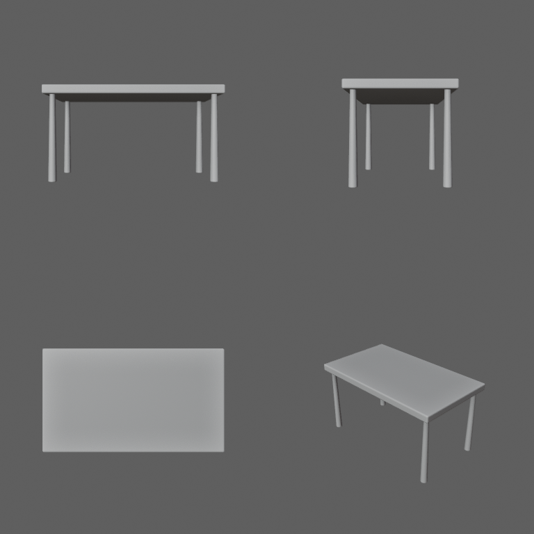

# Blender MCP

**Blender MCP** is a Blender add-on that enables AI-powered 3D content creation through the **Model Context Protocol (MCP)**. It connects Blender to AI coding assistants like Claude, OpenCode, Cursor, and other MCP-compatible tools, allowing you to control Blender using natural language.

## Editions

- **Legacy** — `legacy/blender_mcp.py`. Original single-file v3 add-on, kept for compatibility.
- **Pro v4 (pre-release)** — [`pro/`](pro/README.md). 61-tool FastMCP bridge plus the precision geometry engine. Both editions use `localhost:9876`; enable only one at a time.

## Status

The default branch contains the **Pro v4 pre-release**, verified with Blender
4.5.4 and 5.2.4 LTS. Evaluated geometry checks detect enclosed solid overlaps,
test containment against closed meshes, and trace support to the ground in
strict mode. Expired requests are cancelled before Blender starts them.

To install the v4 candidate from this repository, use `pro/blender_mcp.py`
and `pro/mcp_server.py`. The [Pro v3.0.0 release](https://github.com/camilin7483/blender-mcp/releases/tag/v3.0.0)
contains the previous `blender_mcp_pro.py` and its matching bridge. See the
[v3 to v4 migration guide](docs/migration-v3-v4.md) before switching editions.



## Documentation

- [Architecture](ARCHITECTURE.md)
- [Security and threat model](SECURITY.md)
- [Contributing](CONTRIBUTING.md)
- [Compatibility](docs/compatibility.md)
- [Migration v3 -> v4](docs/migration-v3-v4.md)
- [Benchmark methodology and results](bench/README.md)
- [Release checklist](docs/release-checklist.md)
- [Changelog](CHANGELOG.md)

## Features


- **Natural Language Control** — Create, modify, and manipulate 3D scenes using plain English
- **Socket Server** — Runs a local server inside Blender (port 9876) that listens for JSON commands
- **Full Blender API Access** — Create objects, materials, cameras, lights, animations, and more
- **Poly Haven Integration** — Download free HDRI, texture, and 3D model assets directly into your scene
- **Deterministic inspection** — Orthographic FRONT/RIGHT/TOP plus ISO,
  silhouette, wireframe, normals and UV checker modes, with camera metadata
  and a reproducible output hash.
- **Benchmarked workflows** — 14 deterministic tasks across all 11 requested categories, with published raw artifacts.
- **Game-ready export** — `godot`, `unity`, `unreal` and `generic-gltf`
  profiles validate scale, materials, UVs, armatures, actions, LOD and
  collision meshes, then reimport the file and compare dimensions.
- **Constraint validation and solving** — Read-only checks plus apply for positioning constraints: mate, align, flush,
  center, offset, distance, parallel, perpendicular, ground contact,
  symmetry, no-intersection, inside and surface contact, with structured
  expected/actual/tolerance/method results.
- **Declarative assemblies** — `create_assembly` builds a desk from
  `dimensions_mm` or any explicit component list; `update_assembly` merges a
  patch and rebuilds without duplicating objects.
- **Animation and rigging primitives** — `keyframe_object` inserts property
  keyframes; `create_armature` builds named bones with parent relationships and
  optional automatic weights.
- **MCP Compatible** — Works with Claude, OpenCode, Cursor, and any MCP-compatible assistant

## Tool profiles

Set `BLENDER_MCP_PROFILE` before starting the bridge to reduce the visible
tool surface. Profiles are `core` (13 tools), `modeling`, `materials`,
`animation`, `rigging`, `geometry_nodes`, `inspection`, `export`, `assets`
and `full` (default, 61 tools). `execute_code` is full-only and remains
disabled in the add-on by default. Unknown profile names fall back to
`core`. Profiles filter bridge registration only; the add-on keeps every
handler.

## How It Works

```
+-------------------+      JSON Commands      +---------------------+
|  AI Assistant     | ----------------------> |  Blender Add-On     |
|  (Claude/Code)    |                         |  (this add-on)      |
|                   | <---------------------- |                     |
|  MCP Client       |      JSON Responses     |  Socket Server      |
+-------------------+                         |  localhost:9876     |
                                              +---------------------+
```

The add-on starts a **socket server** inside Blender on `localhost:9876`. When an AI assistant sends a command, the server executes it using Blender's Python API (`bpy`) and returns the result.

## Installation

### Prerequisites

- **Blender 4.5 LTS or 5.2 LTS** (tested with 4.5.4 and 5.2.4)
- **Python 3.10+** for the bridge (Blender bundles its own interpreter)

### Install the Add-on

1. Open **Blender**
2. Go to **Edit > Preferences > Add-ons**
3. Click **Install from Disk...**
4. Select `pro/blender_mcp.py` (or install `build/blender_mcp_pro-4.0.0.zip` as an extension)
5. Enable **Blender MCP Pro Engine**
6. Find the panel in **View3D > Sidebar > MCP Pro**

The bridge runs outside Blender: `pro/mcp_server.py` (legacy entry point) or
the installed `blender-mcp` console script. The legacy v3 add-on remains at
`legacy/blender_mcp.py` and is not the Pro bridge.

## Usage

### Starting the Server

1. Open Blender
2. Go to **View3D > Sidebar > MCP Pro**
3. Click **Start Server**
4. The server will start listening on `localhost:9876`

### Example Commands

Once the server is running and connected to your AI assistant, you can ask things like:

- "Create a red sphere at position (0, 0, 0)"
- "Add a camera pointing at the origin"
- "Import an HDRI from Poly Haven"
- "Create an animation of a rotating cube"
- "Apply a metallic material to the selected object"

## Technical Architecture

### Server (BlenderMCPServer)

The core of the add-on is the `BlenderMCPServer` class which:

1. Opens a **TCP socket** on `localhost:9876`
2. Listens for **JSON-encoded commands** in a background thread
3. Routes each command to the appropriate **handler function**
4. Returns **JSON responses** with results or error messages

### Available tools

The MCP client discovers the active tools and argument schemas through
`tools/list`. Use `create_parametric_part` for geometry, `create_material`
and `assign_material` for materials, `setup_studio_lighting` for studio
lighting, and `render_multiview_inspection` for image output.

The Pro bridge exposes `search_polyhaven_assets` and
`download_polyhaven_asset` for Poly Haven assets. Sketchfab search and
download use `search_sketchfab_models` and `download_sketchfab_model`.
Downloads from Sketchfab require `SKETCHFAB_API_TOKEN` in Blender's environment.

## Development

```bash
python3 -m venv .venv
.venv/bin/python -m pip install -r requirements-dev.txt -r pro/requirements.txt
.venv/bin/python -m pytest tests/contracts tests/unit tests/integration -q
BLENDER_BIN=/path/to/blender-4.5.4-linux-x64/blender ./scripts/run_blender_tests.sh
```

The Pro tests need a real Blender 4.5 LTS with its event loop. On Linux
without `DISPLAY`, the script uses `xvfb-run`; `blender --background` does not
pump timers. See [`CONTRIBUTING.md`](CONTRIBUTING.md).

## Credits


Original code by **Siddharth Ahuja** (github.com/ahujasid)
Repository maintained by **CamiloDev**

- Poly Haven integration uses the Poly Haven API
- Rodin AI integration for text-to-3D generation
- Replicate integration for AI texture generation

## License

MIT - See LICENSE for details.
