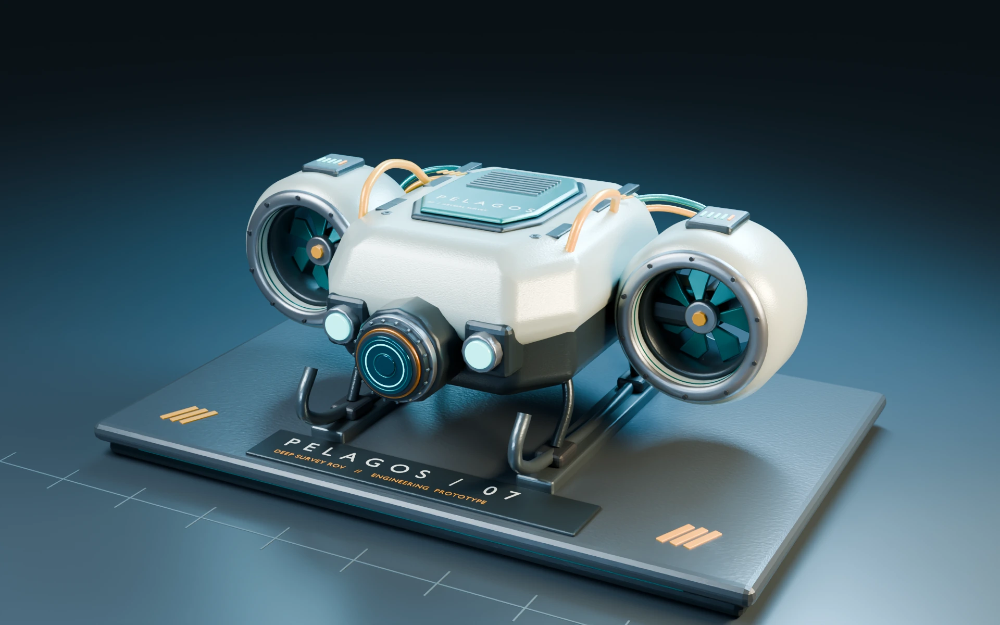
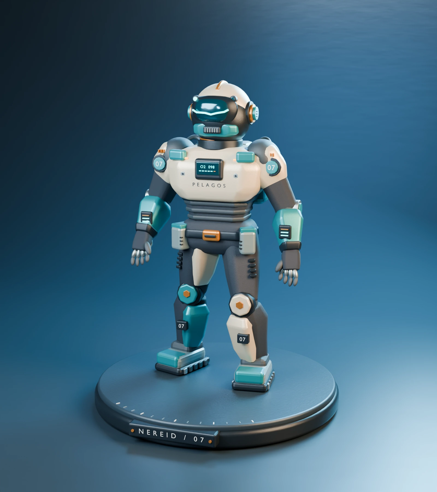

# Blender MCP Pro showcase

Both models are original Blender scenes built from the scripts included here.
The studio images are Cycles renders from Blender 4.5.4 LTS running in
background mode. The scenes contain editable geometry, procedural materials,
lighting, and two cameras each.

## PELAGOS 07



PELAGOS 07 is a subsea inspection ROV with a ceramic pressure hull, dual ducted
thrusters and an optical sensor assembly. Blender evaluated the primary hull
and both thruster ducts as connected, closed meshes with zero non-manifold edges.

[Editable Blender scene](pelagos-07.blend) · [Optics and thruster close-up](pelagos-07-detail.webp) · [Geometry report](pelagos-07.json)

## NEREID 07

<a href="nereid-07.webp"></a>

NEREID 07 is a humanoid survey pilot with a pressure suit, visor, dive
instrumentation, and articulated gloves. A 35-bone armature controls the rigid
suit components. The verification rotates `Forearm.L` by 28 degrees and
measures the evaluated forearm and index finger moving while the cuirass stays
in place. It then restores the presentation pose. Use **Pose Mode** on
`Nereid | articulated survey suit` to pose the model.

[Editable Blender scene](nereid-07.blend) · [Helmet and cuirass close-up](nereid-07-detail.webp) · [Geometry and pose report](nereid-07.json)

## Reproduce

Run these commands from the repository root with Blender 4.5.4 or 5.2.4 on
your path. Each generator runs in a fresh background session and replaces its
own output files.

```bash
blender -b --factory-startup --python-exit-code 1 \
  --python scripts/render_showcase.py -- \
  --width 1920 --samples 48 --detail --output out/showcase/pelagos

blender -b --factory-startup --python-exit-code 1 \
  --python scripts/render_pilot_showcase.py -- \
  --width 1600 --samples 40 --detail --output out/showcase/nereid

blender -b --factory-startup --python-exit-code 1 \
  --python tests/blender/check_showcase.py
```

The generators call the Pro modeling, material and armature methods directly
on Blender's main thread and use `bpy` for custom geometry and staging. They
write PNGs and a JSON report alongside the `.blend` files. The WebP previews
on this page come from those PNGs. Add `--check-only` to skip lighting renders
while still building and checking the scenes. Linux CI also reopens the
checked-in project files and verifies the saved pose rig.
