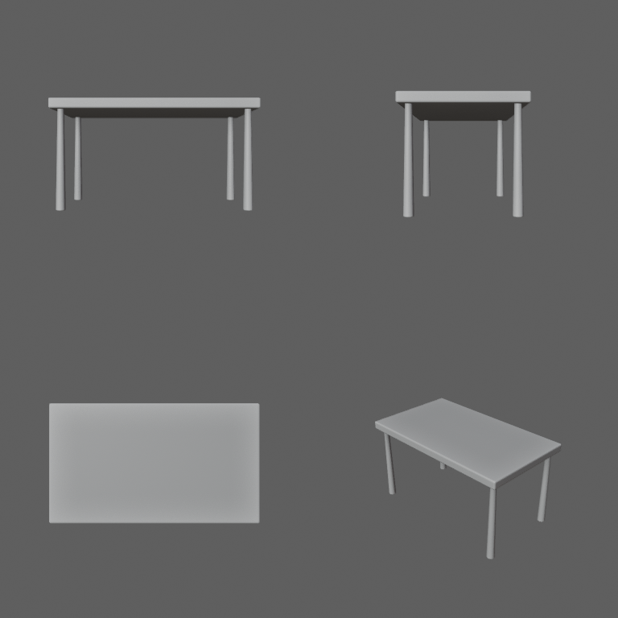

# Blender MCP Pro setup and operation

The bridge exposes 313 tools over MCP stdio in the `full` profile. It sends
authenticated commands to the Blender add-on on `localhost:9876`. Blender
executes those commands on its main thread.

[Tool reference](../docs/tools.md) · [Workflow examples](../docs/workflows.md)
· [Modeling protocol](MODELING_SYSTEM_PROMPT.md) · [Changelog](../CHANGELOG.md)

## Set up Pro

Use Blender 4.5 LTS or 5.2 LTS and a separate Python 3.10+ environment for the
MCP bridge. The Linux suites run on 4.5.4 and 5.2.4 with `mcp` 1.30.0.

1. Disable the legacy Blender MCP add-on if it is active. Both editions use the same local port and Blender operator names.
2. Download [the v4.9.0-alpha.2 extension ZIP](https://github.com/camilin7483/blender-mcp/releases/download/v4.9.0-alpha.2/blender_mcp_pro-4.9.0.zip).
   In Blender, open **Edit → Preferences → Get Extensions** and select
   **Install from Disk** from the top-right menu. Select the ZIP and enable
   **Blender MCP Pro** if prompted. Open the **MCP Pro** tab in the
   3D Viewport sidebar (`N`) for the server controls.
3. For an existing client configured with the Python entry point, check out
   the source matching your installed ZIP. Open the repository's `pro/`
   directory and install the bridge dependencies.

   ```bash
   python3 -m venv .venv
   .venv/bin/python -m pip install -r requirements.txt
   ```

4. Configure your MCP client to launch `mcp_server.py` over stdio using the
   virtual environment's Python. Replace the example paths with the actual
   absolute paths. On Windows, use `.venv\Scripts\python.exe`.

   ```json
   {
     "mcpServers": {
       "blender-mcp-pro": {
         "command": "/absolute/path/to/blender-mcp/pro/.venv/bin/python",
         "args": ["/absolute/path/to/blender-mcp/pro/mcp_server.py"]
       }
     }
   }
   ```

   Clients with their own configuration use the same executable and argument. [OpenCode local MCP setup](https://opencode.ai/docs/mcp-servers/)

5. Ask the client to inspect the active scene with `get_scene_info`. Then try a work request such as “Build a table from the metric blueprint, check its ground contact, and show the four inspection views.”

The [root installation guide](../README.md#installation) shows the
`blender-mcp` console entry point for a new client configuration.

## Build from source

From the repository root on `main`, use Bash and a host Python 3.11+ to build
the extension ZIP. Install the bridge from the same checkout.

```bash
python3 -m venv .venv
.venv/bin/python -m pip install .
BLENDER_BIN=/absolute/path/to/blender ./scripts/build_extension.sh
/absolute/path/to/blender --factory-startup --command extension validate build/blender_mcp_pro-4.9.0.zip
```

Install the ZIP from `build/` with Blender's **Install from Disk** menu.

## Example inspection

The [showcase gallery](../docs/showcase/README.md) contains the PELAGOS 07
vehicle and the rigged NEREID 07 humanoid with editable scenes, renders and
verification reports.

This table was built with the metric `table` blueprint and passed `audit_3d_model` with a score of 100. The image is the PNG returned by `render_multiview_inspection`.



## Local configuration

| Environment variable | Where to set it | Purpose |
| --- | --- | --- |
| `BLENDER_MCP_PROFILE` | MCP bridge | Select one of the [29 profiles](../docs/tools.md#profiles). Restart the bridge to apply a change. |
| `BLENDER_MCP_TOKEN_FILE` | Blender and the MCP bridge | Override the token file path. Defaults to `$XDG_CONFIG_HOME/blender-mcp/token` (usually `~/.config/blender-mcp/token`) on Linux/macOS or `%APPDATA%\blender-mcp\token` on Windows. |
| `BLENDER_AUTH_TOKEN` | Blender and the MCP bridge | Override the token value. Supply the same value to both processes. |
| `BLENDER_MCP_ALLOW_NO_AUTH` | Blender and the MCP bridge | Unsafe: disable local authentication. Use only for a trusted local process that cannot read the token file. |
| `BLENDER_MCP_ALLOW_EXECUTE_CODE` | Blender | Enable `execute_code`. Prefer the add-on preference; this variable is for automation. |
| `BLENDER_MCP_ALLOW_UNSAFE_OPS` | Blender | Skip the dry-run for `clear_scene`, `delete_object`, `rollback_checkpoint` and `setup_studio_lighting`. Unsafe; use only for trusted automation. |
| `BLENDER_MCP_OUTPUT_DIR` | Blender | Export sandbox. Default: `~/BlenderMCP/output`. Relative export paths resolve here; absolute paths must stay inside. |
| `BLENDER_MCP_ALLOW_ANY_PATH` | Blender | Disable the export sandbox. Unsafe; use only for trusted automation. |
| `BLENDER_HOST`, `BLENDER_PORT` | MCP bridge | Socket destination. The add-on listens on `localhost:9876` in a standard installation. |
| `SKETCHFAB_API_TOKEN` | Blender | Required by the Sketchfab download tool. |

Authentication is required by default. The add-on creates the token file
with mode 0600 on POSIX. The server binds to loopback, and `execute_code`
requires explicit opt-in. See the [security model](../SECURITY.md).

## Troubleshooting

| Symptom | What to check |
| --- | --- |
| Connection refused | Use Blender's interactive session and check **MCP Pro** for server status. The socket dispatcher needs Blender's GUI event loop. |
| Authentication failed | Check that the bridge and Blender can read the same token file as the same user. Use the same `BLENDER_MCP_TOKEN_FILE` on both sides if you override it. |
| Tool missing | Check `BLENDER_MCP_PROFILE`, restart the bridge, and use `tools_catalog` to list active tools. Install the bridge and the extension from the matching release or checkout. |
| Queue timeout | Inspect the scene before retrying an operation that may already have started. For long calls, wait for Blender's current task to finish before starting another. |
| Export path rejected | Use a path relative to `BLENDER_MCP_OUTPUT_DIR` and an extension supported by the export profile. |

## License and credits

See the [repository license](../LICENSE) and [project credits](../README.md#credits).
